# Measurements

How every body measurement is defined on the Anny mesh (fit-engine-poc group 4); task 3.1 aligns the step-3 definitions with the Figma "i" texts.

## Measurement definitions (task 4.6)

`measure.measure_body(model, phenotype, pose)` returns every measurement below for one pose; an unknown pose is refused with the list of presets before any body is built (task 3.6). The same request gives the same numbers: two separate runs of three bodies in three poses agreed in all 258 values to 0.0 cm (2026-10-14; `test_measure.py` checks 0.1 mm, task 3.7) (`Measurements`: girths, limb profiles and lengths, in cm). All are taken on the posed mesh, so each pose has its own values. Each figure shows a man of 178 cm and 75 kg standing (two views) and in `hoods`; `scripts/measurement_figures.py` draws them.

**Which faces are cut.** A plane at chest height in a riding pose also cuts the arms reaching forward, and a plane across a thigh cuts the buttock. So each planar girth is taken on one body part's own faces (`body.body_parts`), each vertex belonging to its heaviest bone in Anny's skinning: the **torso** (no arm or leg bones), the **left upper arm** (`upperarm01/02.L`) and the **left thigh** (`upperleg01/02.L`). A part's section can be open where its neighbour was attached; the tape then spans the gap (`tape.hull_girth`, formulas.md).

**Torso up** is the unit vector from `crotch` to `c7`. It leans forward with the torso in a riding pose; chest and waist planes are square to it.

### `chest_girth`

The fullest tape girth of the torso faces square to the torso, searched every 1 cm from 1 to 10 cm below the midpoint of `armpit.L` and `armpit.R` (`CHEST_SEARCH_CM`). Over the bust for women, under the arms for both.

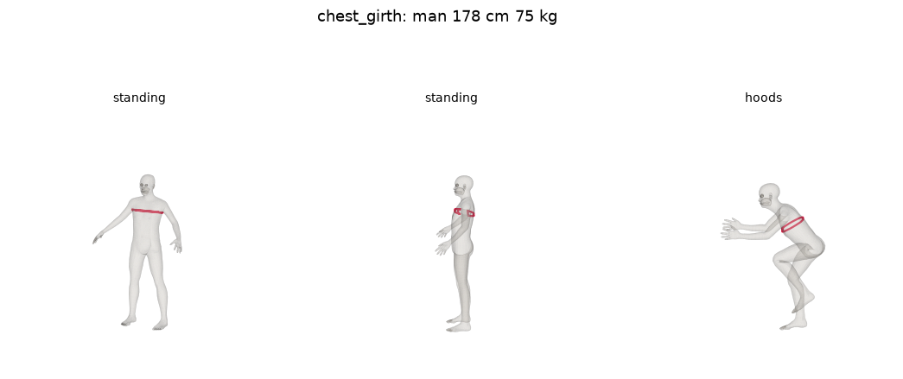

### `waist_girth`

Tape girth of the torso faces square to the torso, through the centre of Anny's own waist ring (`waist_ring`, from `anny.anthropometry`).

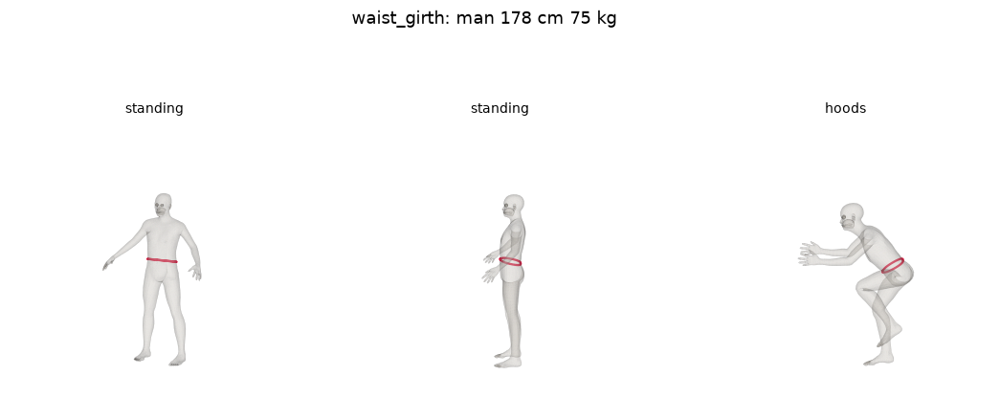

### `hip_girth`

Tape girth around a ring of skin vertices, `hip_ring` in `data/landmarks.json`: the vertices along the fullest horizontal section of the standing template between the crotch and the waist (the section that also gives `hip_back`). In every pose the girth is taken on the same vertices (`tape.ring_girth`: the convex hull of the ring in its best-fit plane), like a waistband sewn to the skin, which is how a bib's hip band moves.

Why a ring and not a plane: with the hips flexed, a plane at the seat runs along the thighs. Square to the torso it read 130 cm for a 181 cm man in `drops` (into the thighs); with the thighs cut away, 46 cm (only a sliver of the seat left). The ring reads 103.3, 99.2 and 97.1 cm for him standing, in `hoods` and in `drops`: the band tilts with the pelvis and its front, across the hip crease, shortens. The figure draws the ring vertex by vertex, which zigzags between neighbouring rows of the mesh; the tape reads their hull.

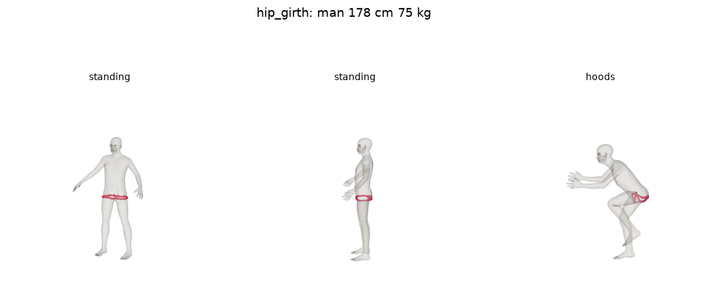

### `upper_arm_girth`

A profile: tape girths of the left upper arm's faces, square to the bone from the shoulder joint (`upperarm01.L` head) to the elbow joint (`lowerarm01.L` head), every `PROFILE_STEP_CM` = 2 cm, ending `LIMB_END_BEFORE_JOINT_M` = 4 cm before the elbow joint (Anny gives the last few cm to the forearm bones, so a section there cuts only part of the arm: for a thin 190 cm man, 20.8 cm at 4.4 cm before the elbow, 18.3 cm at 2.4 cm, nothing at the joint). It starts where the arm leaves the torso: level with `armpit.L` on the standing body, kept as a fixed distance along the bone in every pose (`limb_starts`), so a profile index is the same place on the arm in every pose. The engine reads the level where a sleeve opening sits (`tape.profile_at`).

### `thigh_girth`

A profile like the upper arm's, on the left thigh's faces from the hip joint (`upperleg01.L` head) to 4 cm before the knee joint (`lowerleg01.L` head), starting level with `crotch` on the standing body. "25 cm below the crotch" is index 12.5 of the profile, interpolated.

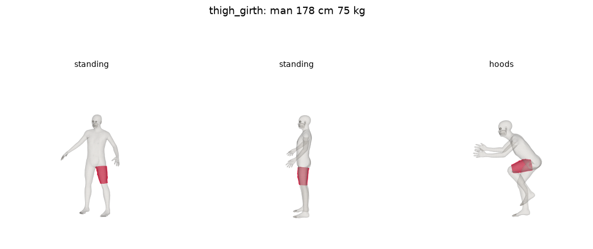

### `back_length`

C7 down the spine to the back hip line along the skin; defined in "Back length and vertical trunk girth" below.

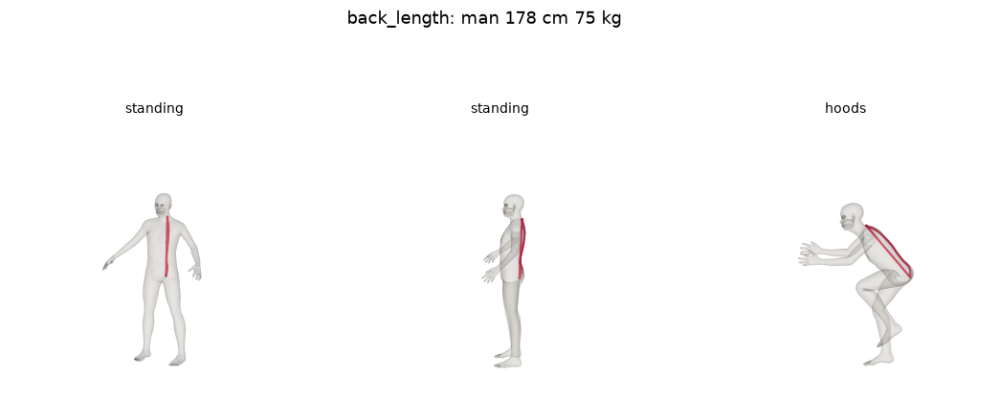

### `vertical_trunk_girth`

Shoulder top down the front, through the crotch and up the back along the skin; defined in "Back length and vertical trunk girth" below.

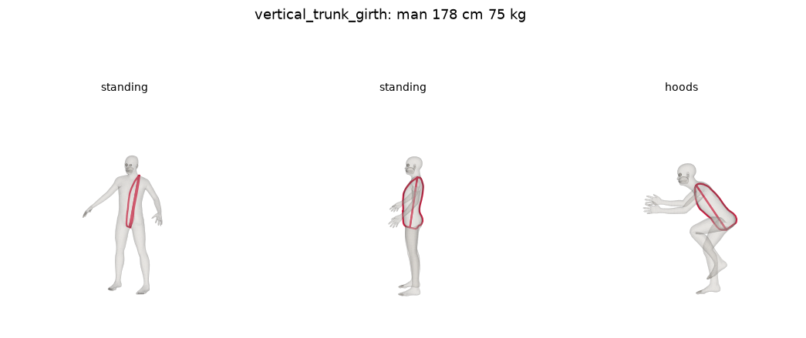

### Check against ANSUR II

Our standing measurements against what ANSUR II predicts for the same sex, height and weight (`scripts/measurement_figures.py data/external/ansur2`, run 2026-10-14; limb girths are the largest of the profile's first 10 cm; ours / ANSUR II, cm):

| Body | chest | waist | hip | upper arm | thigh | vertical trunk |
|---|---|---|---|---|---|---|
| man 178 cm 75 kg | 99.6 / 98.8 | 87.7 / 84.8 | 102.1 / 96.1 | 33.8 / 33.2 | 58.4 / 57.8 | 168.3 / 162.1 |
| woman 165 cm 60 kg | 86.3 / 88.5 | 79.3 / 78.3 | 104.0 / 96.6 | 28.1 / 28.1 | 59.5 / 57.3 | 155.0 / 152.9 |
| man 185 cm 100 kg | 110.4 / 111.9 | 104.5 / 101.2 | 113.4 / 108.1 | 37.4 / 37.8 | 66.2 / 66.6 | 179.5 / 175.8 |
| woman 170 cm 85 kg | 100.4 / 104.3 | 101.3 / 97.8 | 114.6 / 112.1 | 32.0 / 34.3 | 68.6 / 68.8 | 169.5 / 166.1 |

Chest, waist and thigh agree within about one ANSUR residual SD ("Uncertainty" below); the upper arm within two, ours relaxed and ANSUR's flexed. Our hip girth runs 2.5–7.4 cm above ANSUR's buttock circumference and our vertical trunk girth 2–6 cm above: the definitions differ (ANSUR measures the buttocks' maximum horizontally on a standing subject; its vertical trunk circumference is taken over the shoulder with the subject standing straight), and Anny's MakeHuman bodies are not soldiers. These offsets are what the study's tape measurements (group 8) will settle; until then the fit ranges are calibrated on our own measurements, so a constant offset does not change a size.

## Landmarks (task 4.1)

A landmark is one vertex of Anny's `anny` topology. The topology is the same for every body, so an index found once on a template body marks the same anatomical point on every body and in every pose (the vertex moves with the skin).

The indices live in [`data/landmarks.json`](../../data/landmarks.json), generated by `scripts/mark_landmarks.py` from a template body (male, 178 cm, 75 kg, standing) with these rules:

| Landmark | Rule |
|---|---|
| `c7` | Back midline vertex closest in height to the `neck01` bone head (base of the neck) |
| `acromion.L`, `acromion.R` | Highest vertex within 5 cm, horizontally, of the shoulder joint (`upperarm01` head) |
| `shoulder.L`, `shoulder.R` | Top of the shoulder, where a bib strap lies: highest vertex within 1.5 cm, horizontally, of the point halfway between the `neck01` head and the shoulder joint, and below the `neck01` head + 6 cm (higher, the column reaches the side of the head) |
| `armpit.L`, `armpit.R` | Scanning horizontal sections down from the shoulder joint, the torso-side point where the arm first separates (the section's width drops by 3 cm) |
| `waist_front` | Front-most vertex of Anny's own waist ring (`anny.anthropometry`, also stored as `waist_ring`) |
| `waist_back` | Vertex of Anny's waist ring on the back closest to the midline |
| `hip_back_midline` | Back midline vertex closest in height to `hip_back`: the back hip line |
| `hip_back` | Back-most point of the torso section with the largest girth between 3 cm above the crotch and the waist |
| `crotch` | Lowest midline vertex above the knees |
| `elbow.L`, `elbow.R` | Back-most vertex within 5 cm of the elbow joint (`lowerarm01` head) |
| `knee.L`, `knee.R` | Front-most vertex within 6 cm of the knee joint (`lowerleg01` head) |

"Midline" means |x| < 3 mm; Anny's world axes are +X left, −Y forward, +Z up.

### Check on 5 bodies

`scripts/mark_landmarks.py` renders the landmarks on five bodies standing (front, side, back) and in `hoods` (side), and tabulates landmark heights as a share of stature against rough adult ranges, to catch a misplaced landmark:

- [`measurements/landmarks-check.md`](measurements/landmarks-check.md)
- `measurements/landmarks-male-178-75.png`, `landmarks-female-165-60.png`, `landmarks-male-190-95.png`, `landmarks-female-175-58.png`, `landmarks-male-168-72.png`

The rules are a first version. If a render shows a landmark in the wrong place, the rule changes and the file is regenerated; the landmark names stay.

**Run 2026-10-14 (anny 0.6.1):** every landmark height falls in its expected range on all five bodies (c7 0.85–0.86, armpits 0.75–0.76, waist_front 0.59–0.62, hip_back 0.50–0.51, crotch 0.47–0.49 of stature). The renders show each landmark on its anatomical point, standing and in `hoods`. `hip_back` sits on the peak of one buttock, not on the midline: the rule takes the back-most point, and the buttocks bulge either side of the midline. A back-length path (task 4.4) that needs a midline point uses the midline vertex at the same height.

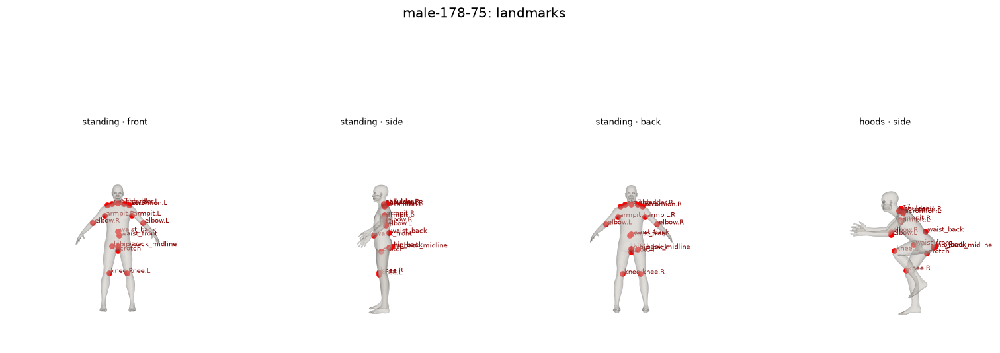
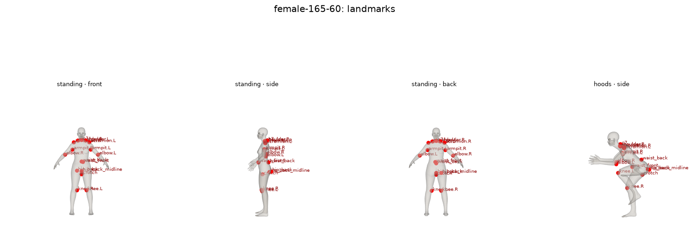

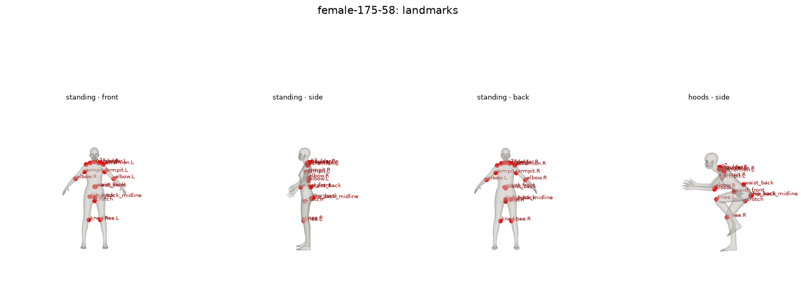
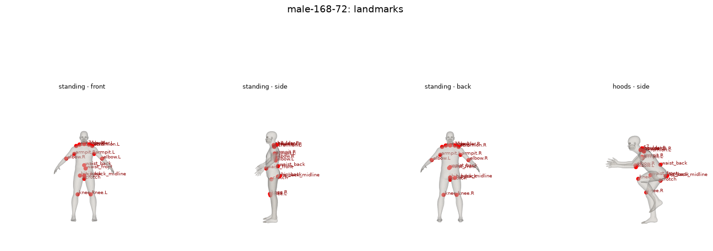

`shoulder.L/R`, `waist_back` and `hip_back_midline` were added for task 4.4 (run 2026-10-14); the earlier twelve indices did not change.

## Back length and vertical trunk girth (task 4.4)

Both are measured along the skin, as a surface path between landmarks on the posed mesh (`measure.py`, derivation in [formulas.md](formulas.md), "Surface paths"):

- **Back length:** from `c7` down the spine to `hip_back_midline`, in the plane through both that is square to the shoulders' left-right axis (`acromion.L` − `acromion.R`), on the side of `waist_back`.
- **Vertical trunk girth:** from `shoulder.L` down the front to `crotch` (plane through shoulder, crotch and `waist_front`) and back up from `crotch` to `shoulder.L` (plane through shoulder, crotch and `waist_back`). It is the body counterpart of a bib's front rise + strap + back rise. Where the thighs touch, a section runs down a thigh before it reaches the crotch; within 1 cm of the crotch's height (along the crotch → C7 axis) the path crosses straight to the crotch, as a tape pulled between the legs does.

**Check on 10 bodies** (`scripts/body_lengths.py`, run 2026-10-14; `test_measure.py` asserts the same):

| Body | back standing | back `hoods` | change | trunk standing | trunk `hoods` | change |
|---|---|---|---|---|---|---|
| female 158 cm 50 kg | 59.1 | 60.0 | +0.9 | 147.8 | 137.5 | −10.3 |
| female 165 cm 60 kg | 61.4 | 62.5 | +1.2 | 155.0 | 144.2 | −10.8 |
| female 170 cm 85 kg | 64.1 | 66.6 | +2.5 | 169.5 | 156.9 | −12.5 |
| female 175 cm 58 kg | 63.7 | 64.6 | +0.9 | 157.6 | 146.9 | −10.7 |
| female 182 cm 70 kg | 65.9 | 67.0 | +1.1 | 165.1 | 152.9 | −12.2 |
| male 168 cm 72 kg | 61.1 | 62.5 | +1.4 | 163.3 | 150.5 | −12.8 |
| male 175 cm 64 kg | 62.3 | 63.1 | +0.8 | 161.8 | 149.1 | −12.7 |
| male 178 cm 75 kg | 63.7 | 64.9 | +1.1 | 168.3 | 154.5 | −13.8 |
| male 185 cm 100 kg | 66.3 | 68.3 | +1.9 | 179.5 | 166.2 | −13.3 |
| male 195 cm 88 kg | 68.4 | 69.5 | +1.1 | 178.4 | 164.5 | −13.8 |

The back is longer in `hoods` on all ten bodies, as the spec requires. Two things to keep in mind:

- **The back stretches only 1–2.5 cm (2–4 %).** Most of the `hoods` lean is at the hip, and Anny's linear blend skinning stretches the skin over a flexing spine less than real skin does. The calibration (group 8) may need a correction term; the study's tape measurements in the riding position will tell.
- **The vertical trunk girth shrinks by 10–14 cm.** Folding at the hip shortens the front far more than the back lengthens. For bibs this is the expected direction: the front rise bunches and the back rise and straps take the load.

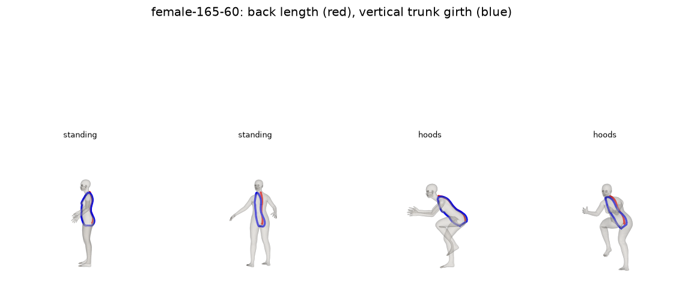
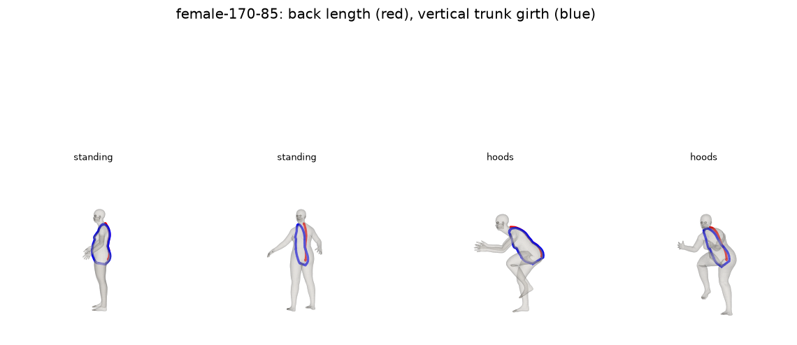
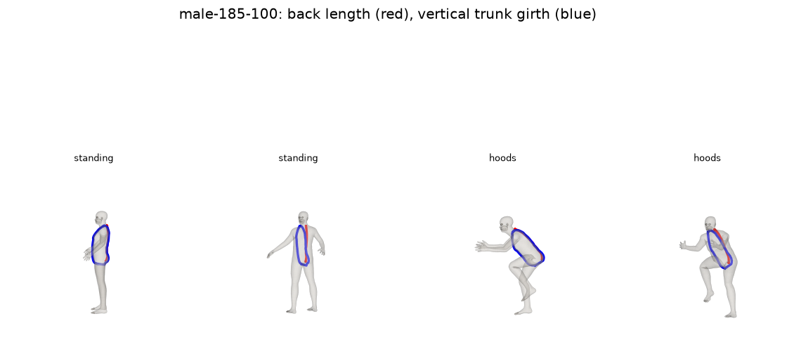

## Uncertainty (task 4.5)

Each measurement carries a standard deviation (`uncertainty.py`), which the confidence of a size recommendation samples from (design D8).

**Not entered by the shopper:** the measurement is predicted from sex, height and weight, with the residual SD of the regression *measurement ~ stature + weight + BMI* over ANSUR II, the US Army's 2012 anthropometric survey (public domain; `scripts/ansur_sds.py`, run 2026-10-14; the CSVs are downloaded by hand to `data/external/ansur2/`, which git ignores).

| Measurement | ANSUR II column | Men: SD given height and weight / SD of the population (cm) | Women |
|---|---|---|---|
| chest_girth | chestcircumference | 3.19 / 8.74 | 4.24 / 8.27 |
| waist_girth | waistcircumference | 4.37 / 11.17 | 4.82 / 9.99 |
| hip_girth | buttockcircumference | 2.60 / 7.67 | 2.91 / 7.59 |
| upper_arm_girth | bicepscircumferenceflexed | 1.88 / 3.46 | 1.39 / 3.08 |
| thigh_girth | thighcircumference | 2.25 / 5.85 | 2.26 / 5.58 |
| back_length | waistbacklength | 2.07 / 2.77 | 2.08 / 2.64 |
| vertical_trunk_girth | verticaltrunkcircumferenceusa | 3.97 / 8.95 | 3.77 / 7.60 |

Height and weight explain most of the spread: the chest's SD falls from 8.7 to 3.2 cm for men. Caveats, each a reason the real SDs for shoppers are likely somewhat larger:

- **Population.** ANSUR II measured 4082 male and 1986 female soldiers: fitter and younger than shoppers, with fewer very light or very heavy bodies.
- **Definitions.** ANSUR's biceps girth is flexed (ours relaxed); its waist back length runs from C7 to the waist (ours to the hip line). The SDs are used as the closest available.
- **Model error is not included.** These are the SDs of a perfect regression; Anny's body for given height and weight is not that regression. The study (group 8) compares engine measurements with tape measurements and may raise them.

**Entered by the shopper (step 3):** a self-taken tape measurement has an SD of 5 % of its value (`SELF_MEASURED_SD_SHARE`). Source: self- minus researcher-measured waist circumference had an SD of 4.82 cm at a mean of 96.6 cm, 617 adults with a mailed tape and written instructions (Contardo Ayala, Nijpels, Lakerveld, BMC Medicine 2014;12:170). The same share is assumed for chest, biceps and thigh. The prediction and the self-measurement are combined as two independent estimates (formulas.md, "Combining two estimates"), so an entered measurement always narrows the SD: with a 100 cm chest a man's chest SD falls from 3.19 to 1/√(1/3.19² + 1/5²) = 2.69 cm.

Hip girth, back length and vertical trunk girth have no step-3 input and keep the predicted SD.
